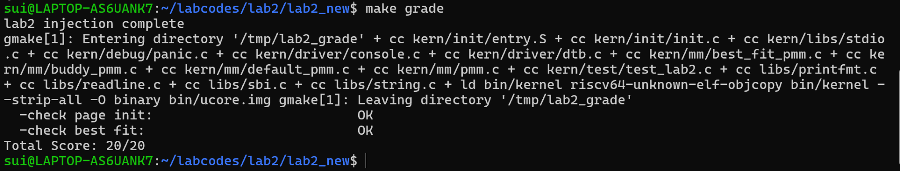
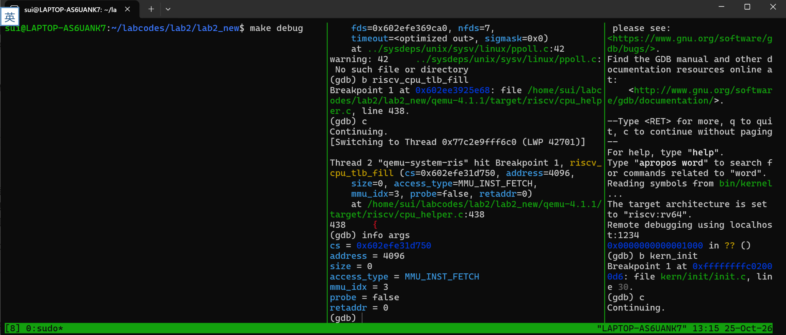
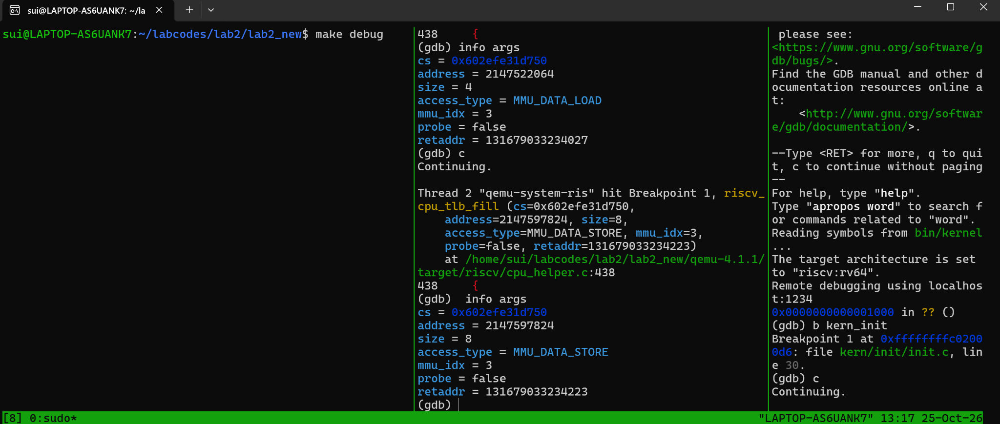
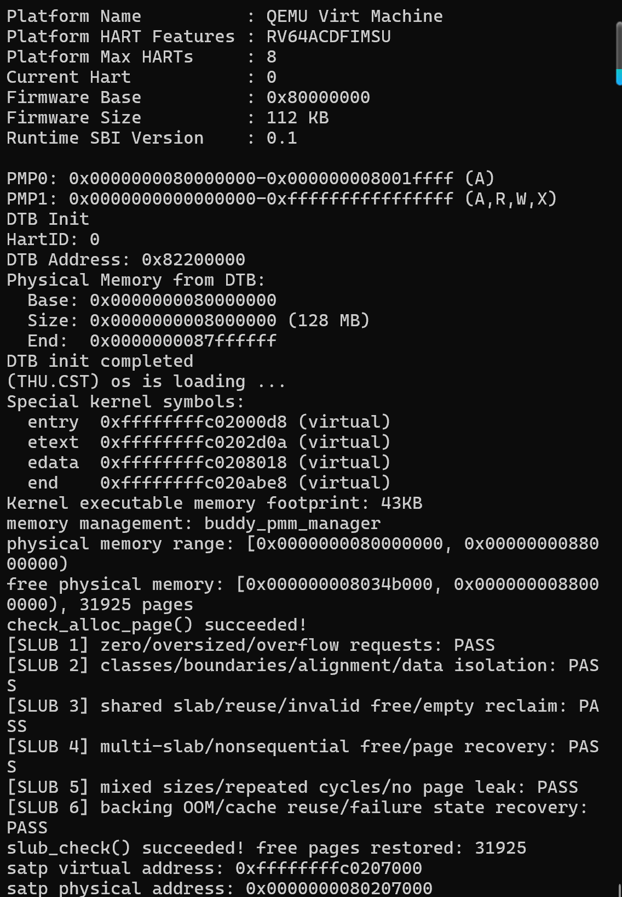
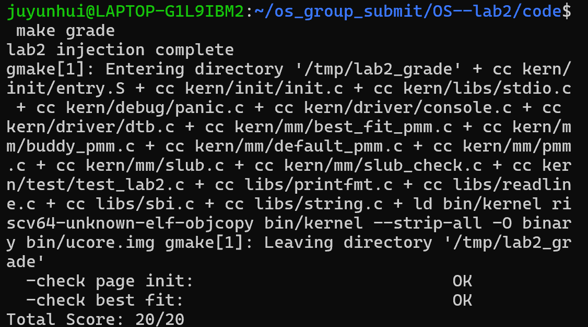

# 操作系统实验报告

## 实验基本信息

| 项目 | 内容 |
|---|---|
| 实验名称 | Lab2：物理内存管理、页表与SLUB对象分配挑战 |
| 小组成员 | 2411564－刘欣怡、2411846－鞠昀慧、2411690－白诗雨 |
| 原实验记录日期 | 2026-10-23 |
| 本次报告补充日期 | 2026-10-25 |
| 本次新增内容 | 鞠昀慧的Sv39/TLB深入调试记录；教学版SLUB模块、独立测试及两份prompt |

> 验证状态：最终组工程保留原Buddy与启动代码，合入SLUB和Best-Fit两处尾插修复。Best-Fit与Buddy的六项SLUB测试均PASS，分别恢复31926和31925页；官方基础评分20/20。随后补齐page_init边界保护，官方评分再次20/20。个人旧工程的31854页及四项Buddy PASS单独记录，不混作最终组工程输出。最终组工程截图见第5节。

### 小组分工

以下分工基于原报告，并补充鞠昀慧已实际完成的深入调试及本次SLUB工作。小组最终归档时由三人核对实际贡献；协作部分可同时列名。

| 成员 | 实验与代码工作 |
|---|---|
| 刘欣怡 | 物理内存探测与`page_init`实现、First-Fit分析、总体流程梳理 |
| 鞠昀慧 | Best-Fit实现与验证；S态Sv39页表查询、TLB未命中与回填的深入调试；借助AI设计SLUB模块与独立测试，负责个人及组工程接入、两种底层复测；补充page_init上界及描述符容量保护；整理报告和答辩说明 |
| 白诗雨 | Buddy System实现与测试；QEMU取指、读、写三类访问的初步断点观测 |
| 三人共同 | 代码与报告交叉核对、知识点总结、个人答辩准备 |

| 成员 | 负责的报告部分 |
|---|---|
| 刘欣怡 | 整体逻辑、初始化、First-Fit思考题 |
| 鞠昀慧 | Best-Fit、个人Sv39/TLB验证、SLUB设计与测试、相关SPEC/prompt记录 |
| 白诗雨 | Buddy实现及测试覆盖、三类访存观测说明 |
| 三人共同 | 实验总结、材料核验与最终整理 |

## 一、实验目的

1. 从DTB取得RAM范围，区分物理地址、虚拟地址、物理页号和Page描述符地址。
2. 建立Page描述符数组，保护固件、内核与管理元数据，注册安全的完整空闲页。
3. 理解First-Fit并实现Best-Fit，掌握拆分、回收、连续性判断和合并。
4. 实现Buddy及相应测试，理解按阶组织、向上取整、分裂和伙伴合并。
5. 使用双层GDB，区分客户机内核与宿主QEMU，观察实际的Sv39查表、软件TLB miss及回填。
6. 在已有页分配器之上实现简化SLUB式对象层，支持按字节请求、页内对象复用和空slab归还，并用独立测试检验状态恢复。

## 二、实验环境与AI工具

### 2.1 运行环境

- Windows + WSL Ubuntu；QEMU virt模拟RISC-V 64位机器，默认128MiB RAM。
- 鞠昀慧已确认本机`qemu-system-riscv64 --version`为4.1.1，固件横幅为OpenSBI v0.4。
- 内核调试器：`riscv64-unknown-elf-gdb`，用户已贴出的版本为SiFive GDB-Metal 10.1。
- 宿主调试器：普通`gdb`；QEMU调试构建保留`debug_info`，未strip。
- 用户旧汇编器不接受`rv64imac_zicsr_zifencei`，已将本机编译选项调整为`rv64imac`。SLUB安装脚本保留该修改，不覆盖整个Makefile。

### 2.2 AI工具与模型

| 成员 | AI编程工具 | 底层模型记录 |
|---|---|---|
| 刘欣怡 | Claude Code（原报告记录） | 原报告写`claude-fable-5`，需由本人以实际客户端/会话记录核对 |
| 鞠昀慧 | ChatGPT网页端，辅助代码、原理、调试和报告整理 | 历史具体型号未留存，不能仅依据AI自述或当前选择倒推历史；以可核验界面记录补充 |
| 白诗雨 | Claude Code（原报告记录） | 原报告写`claude-fable-5`，需由本人以实际客户端/会话记录核对 |

工具是使用AI的软件，模型是该软件调用的具体模型；两栏不应都填“ChatGPT”。未确认的型号如实标注，不能统一复制组长的配置。

## 三、实验整体逻辑分析

### 3.1 实际执行主线

`entry.S`先保存hart ID与DTB物理地址，设置预置Sv39根页表并切换到高地址内核；`kern_init()`清BSS、调用`dtb_init()`解析设备树，随后进入`pmm_init()`。

物理页管理主线是：

```text
pmm_init
  -> init_pmm_manager：选择并初始化分配策略
  -> page_init：计算Page数组与安全空闲区
       -> init_memmap：交给当前策略组织空闲块
  -> check_alloc_page：运行当前策略自测
```

因此，`page_init()`建立的是物理页管理状态，不能把它说成创建启动MMU页表的函数。DTB解析也在`dtb_init()`中完成，`page_init()`使用的是已解析的base/size。

### 3.2 机制与策略

`pmm_manager`包含`init`、`init_memmap`、`alloc_pages`、`free_pages`、`nr_free_pages`、`check`等函数指针。统一接口提供页的申请与释放，具体选块规则由注册的First-Fit、Best-Fit或Buddy实现决定。

新增SLUB位于这些策略上方：底层分配物理页；上层从页中分配小对象。SLUB不是替代`pmm_manager`的第四种页级选块策略。

## 四、实验内容与实现

### 4.1 功能模块一：物理内存初始化

**原负责人：刘欣怡；鞠昀慧完成个人运行复核。**

`page_init()`读取`get_memory_base()`和`get_memory_size()`，验证范围与溢出，取DTB末端和框架`PHYSICAL_MEMORY_END`的较小者并向下页对齐。设置`va_pa_offset`、`npage`，在内核`end`之后向上页对齐放置`pages`数组。

所有描述符先设Reserved，数组自身占用的物理页也保留。数组物理末端向上对齐后，只有非空的完整页区间才调用`init_memmap()`；非法DTB或元数据放不下时panic，没有完整空闲页时不注册空区。最终组工程保留刘欣怡原函数，鞠昀慧新增DRAM_BASE一致性、PHYSICAL_MEMORY_END上界、上界向下对齐和数组容量保护，新增注释标2411846。该保护后官方回归20/20；异常DTB分支未逐项注入运行，不声称已覆盖所有错误路径。

默认配置下，成员实测：

| 项目 | 值 |
|---|---|
| RAM物理范围 | `[0x80000000,0x88000000)` |
| `npage` / `nbase` | `0x88000` / `0x80000` |
| 描述符覆盖页数 | `32768` |
| Best-Fit旧构建的Page数组VA | `0xffffffffc0207000` |
| 初始空闲物理起点 | `0x80347000` |
| 空闲页数 | `31929` |

`npage`是绝对物理页号上界，不是总页数；`pa2page(pa)`返回描述该物理页的结构体地址，不是把PA简单转换成数据指针。描述符数组、内核大小随构建变化，新增SLUB后不要求仍输出31929。

各任务SPEC和prompt见`prompt.md`，其中第9节为既有任务的四段整理版。原报告关于两次迭代的详细运行故障未附过程日志，本次不将这些推测性描述当作已证实历史；已知的真实个人故障记录见第“五”节。

### 4.2 任务一：First-Fit分析

- `default_init()`：初始化链表头，空闲页数清零。
- `default_init_memmap()`：开放安全页区，块首页property记录连续页数，按地址挂入空闲块链表。
- `default_alloc_pages()`：从头寻找第一个`property >= n`的块，摘除、分配，必要时把余块插回。
- `default_free_pages()`：按地址插回，检查物理连续性，再与前后空闲块合并。

“链表相邻”和“物理连续”不能混同。只有`前块首页 + 前块页数 == 后块首页`时才能按连续块合并。合并可以减少外部碎片，但不能声称消除所有碎片。

**改进空间：**Next-Fit可改变扫描起点；分桶或按大小索引可加快候选搜索。若用按地址的平衡树加速First-Fit，还需维护子树最大空闲块等辅助信息；仅换成普通按地址树不自动获得满足大小查询的O(log N)。

### 4.3 任务二：Best-Fit实现与个人成果

**负责人：鞠昀慧。**

空闲链表仍按地址排序。分配时遍历候选，维护最小合格块；精确匹配可提前结束。选中后拆分余块，释放时检查前后连续性并合并。

```c
if (p->property >= n &&
    (page == NULL || p->property < page->property)) {
    page = p;
    if (p->property == n) break;
}
```

普通线性实现最坏搜索O(N)。Best-Fit只保证本次选择最小合格块，不保证长期碎片最少；按大小维护平衡树或分桶可以优化搜索，但需维护地址邻接关系与额外元数据。

**验证成果：**鞠昀慧在QEMU4.1.1实际运行Best-Fit并通过官方Page Init和Best-Fit评分，得到20/20。原`basic_check()`、`best_fit_check()`及官方评分断言不修改。

**本次SLUB集成时发现并修复的兼容隐患：**原先沿用的尾插分支在`list_add`后缺少`break`，循环可能再次访问新插入节点并破坏连接。扩展随机申请/释放复测发现这一问题；本次仅在Best-Fit的`init_memmap`和`free_pages`尾插分支补充退出循环，两项原测试逐字保留，修复后重新进行随机复测及官方注入测试。该问题是本次开发验证发现，不能写成先前基础评分失败的原因。

### 4.4 任务三：Buddy System实现与测试

**原负责人：白诗雨；鞠昀慧完成个人运行复核。**

以阶为单位维护不同大小桶，阶k表示2^k页；申请向上取幂并逐级拆分，释放接收原申请页数并取整回收，只有真正同阶空闲伙伴才能合并。

**最终提交保留白诗雨的组版本：**实现和static buddy_check均在buddy_pmm.c，使用BUDDY_MAX_ORDER=31，每桶free_area_t记录空闲块和页数。伙伴通过`(base-pages) ^ (1<<order)`计算，property记录块页数。当前128MiB平台nbase=0x80000且实际可用阶较低，该原点与实际块的物理对齐相容；更换平台需重审，不能泛称所有布局都适用。

组版本`alloc_pages(0)`返回NULL；`alloc_pages(3)`占4页，`free_pages(p,3)`回收完整块。不承诺部分释放或完整非法指针防护。原测试不打印个人工程的Buddy 1～4，而通过check回调后输出check_alloc_page succeeded。

| 组版本测试 | 核心检查 | 为什么有效 |
|---|---|---|
| 单页申请释放 | 三页唯一、ref为0、不在空闲桶、计数恢复 | 发现重复分配和未出链 |
| 非2幂取整 | 3页占4页、对齐、完整释放 | 发现取整和计数错误 |
| 分裂 | 从高阶补低阶空桶，检查余伙伴 | 发现余块丢失和错误选桶 |
| 两半释放与链式合并 | 一半释放不能并，两半释放逐级恢复原块 | 发现过早合并及遗漏高阶合并 |
| 失败边界 | 0、超总量返回NULL；临时隐藏空闲桶模拟耗尽并恢复 | 发现失败路径改坏状态；不是逐页真实耗尽测试 |
| 结构与统计 | 桶计数、块总量、对齐和无可合并伙伴残留 | 避免只看总量而漏掉结构错误 |
| 混合交叉释放 | 1/2/3/5/7页同时申请，不重叠、交叉释放恢复 | 发现多大小交错操作错误 |

最终组Buddy + SLUB启动中check_alloc_page成功，随后六项SLUB PASS，空闲页31925→31925。测试覆盖核心行为，不构成所有输入或多核并发的证明。两份组版本prompt见prompt.md第3、4节和本报告附录。

**个人先前验证另记：**鞠昀慧学习工程使用MAX_ORDER=15、绝对PPN寻伙伴、0页断言、独立buddy_check.c，四条Buddy PASS覆盖取整、不重叠、真实逐页耗尽及1000轮恢复；个人加入SLUB后31854→31854。这些文件没有覆盖进最终组工程，不将其当作组版本代码或测试输出。

### 4.5 Challenge思考：如何获取未知硬件的RAM范围

优先使用平台与引导协议：设备树、UEFI GetMemoryMap、旧式x86的BIOS E820，或bootloader传入的内存图。ACPI表可补充拓扑与属性信息，但不能笼统当作所有平台上完整可用RAM映射的替代来源。

应区分普通RAM、固件保留、MMIO和不可用区。盲目向未知地址写测试值可能覆盖数据、触发设备副作用或异常，不能作为通用安全方法。实际硬件的探测通常依赖固件、控制器配置及平台约定。

### 4.6 分支任务：QEMU页表与软件TLB调试

#### 4.6.1 分工和两层调试

白诗雨提供取指、数据读取和数据写入三类初步断点截图；鞠昀慧进一步完成指定S态数据读取的Sv39查表、软件TLB未命中和回填核验。

终端A运行带符号的QEMU4.1.1；终端B用宿主`gdb`附加QEMU PID；终端C用RISC-V GDB连接QEMU的1234端口控制内核。B附加后先continue，QEMU的调试stub才能响应C。B暂停时C等待是预期现象。

#### 4.6.2 三类截图能证明什么

组员截图均显示`mmu_idx=3`，地址处于复位/固件访问范围。它们能证明捕获了`MMU_INST_FETCH`、`MMU_DATA_LOAD`、`MMU_DATA_STORE`三类软件TLB填充调用，不能仅凭这些参数宣称发生了Sv39遍历。

M态访问通常直接旁路S/U态地址翻译；对数据访问还应检查MPRV/MPP等有效特权条件。截图没有同时给出satp和相关状态，故不把它们当作“MODE=0已实测”的证据。

TLB miss本身也不等于客户机缺页异常。QEMU可以在填充路径成功查表并继续；映射无效、权限不满足等条件才可能产生客户机异常。

#### 4.6.3 鞠昀慧的S态Sv39深入调试成果

内核探针执行`sfence.vma`后，用`ld`读取`mmu_probe_value`，结果写入`mmu_probe_result`。在宿主GDB对指定VA和数据load设置条件断点，获得：

```text
load_helper -> tlb_fill -> riscv_cpu_tlb_fill -> get_physical_address
access_type = MMU_DATA_LOAD
size = 8
mmu_idx = 1
addr = 0xffffffffc0206010
satp = 0x8000000000080205
```

satp MODE为8（Sv39），PPN为0x80205，根表PA=0x80205000。继续单步得到：

| 项目 | 本人实测值 |
|---|---|
| levels / ptidxbits / ptesize | 3 / 9 / 8 |
| 根层idx | 511 |
| PTE所在物理地址 | `0x80205000 + 511*8 = 0x80205ff8` |
| PTE | `0x200000cf` |
| 大页物理基址 | `0x80000000` |
| 大页内偏移 | `0x206010` |
| 完整物理地址 | `0x80206010` |

PTE在根层已经是1GiB叶子，因此本次不查满三级。此版本QEMU函数返回供软件TLB使用的4KiB物理页基址0x80206000，加addr低12位0x10才是完整字节PA。

相关源码位于`target/riscv/cpu_helper.c`和`accel/tcg/cputlb.c`。在后者的`if (!tlb_hit(...))`及`if (!victim_tlb_hit(...))`分支确认未命中后进入`tlb_fill`；不能把所有访存都说成必走该C慢路径。

再切换到load_helper栈帧，发现原TLB标签为0xffffffffffffffff，目标虚拟页为0xffffffffc0206000；调用栈证明主TLB和victim TLB没有提供可用匹配，进入填充路径。返回后`entry->addr_read`变为0xffffffffc0206000，表明回填成功。最终`mmu_probe_result=0x1122334455667788`，读取正确。

上述为成员实际贴出的终端记录摘要；当前上传的三张组员图不包含这一详细过程。可使用本人保存的查表、TLB回填截图补充，不应将组员M态图片改注成此S态记录。

#### 4.6.4 QEMU软件TLB与硬件TLB

软件TLB还保存客户机访问到宿主可访问内存的加速信息，例如addend；即使客户机不进行S/U页表翻译，QEMU仍需处理客户机物理地址到宿主内存的映射。TCG生成代码存在快路径，不能声称每次访问必然进入C函数或每次miss必然发生客户机异常。

当前已完成S态查表和miss/回填；独立的satp MODE=0（Bare）对照尚未补做，也未单独实测后续访问命中。报告不将这两项写成已完成。

### 4.7 新增Challenge：教学版SLUB对象分配器

**本次新增负责人：鞠昀慧，借助ChatGPT辅助设计与实现，负责接入、运行复核及报告说明。**

#### 4.7.1 目标与两层结构

原页分配器只能按页提供内存，若仅需24字节却独占4KiB页会浪费。本模块把对象请求放在页分配器之上：

| 层次 | 接口/职责 |
|---|---|
| 下层物理页分配 | 复用`alloc_pages/free_pages`，兼容Best-Fit和Buddy |
| 上层对象分配 | `slub_alloc(n)`按字节请求，在slab页内复用固定大小槽位 |

实现文件是`slub.c`、`slub.h`；独立测试为`slub_check.c`。本实现体现SLUB式对象缓存的主体思想，并非Linux SLUB完整移植，不包含per-CPU缓存、并发锁、构造函数或NUMA策略。

#### 4.7.2 大小类、元数据和对齐

小对象大小类为16、32、64、128、256、512、1024、2048字节。请求17字节进入32字节类；每个slab只服务一个大小类，页面顶部保存元数据与位图，其后的16字节对齐槽位保存对象。

空闲槽位的前一个指针大小空间暂存下一个空闲对象地址；分配时弹出，释放时压回。对象在分配期间完全归调用者使用，空闲链表指针只在释放后写入。位图区分已分配与空闲槽位，辅助识别重复或不对齐释放。

元数据不占用Page结构体的策略字段，避免与Buddy的阶数或Best-Fit的property语义冲突。

#### 4.7.3 大对象与接口约定

超过2048字节的对象单独申请连续页，页数包含对象头和对齐开销。最大支持请求为64KiB；“任意大小”指上限内的任意字节数，不表示无限制内存或每个请求都没有取整浪费。

- `slub_alloc(0)`、超过64KiB或极大值请求返回NULL，不改变状态。
- 所有返回对象至少16字节对齐；大对象不承诺页对齐。
- `slub_free(NULL)`返回0；成功释放返回0；非法、偏移、当前可识别的重复释放返回-1。
- `slub_usable_size(p)`返回小对象的大小类容量，大对象返回原请求大小；无效指针返回0。
- 不承诺任意额外对齐、realloc、零初始化或完整UAF检测。地址被重新分配后，旧悬空指针的ABA问题不由本模块解决。

#### 4.7.4 申请、释放与整页回收

小对象申请先查找对应缓存中有空槽的slab；没有时向下层申请1页，并把可用区域切分。槽位不足时可继续创建其他slab。

释放时先从已登记slab清单寻找归属，再验证对象边界和位图，避免先解引用一个任意传入的地址。某slab最后一个对象释放后，立即把整个页还给底层；大对象释放直接归还原连续页请求。

Buddy可能向上取整实际页数，因此元数据同时记录“原请求页数”和“实际消耗页数”。释放时传原页数给底层，由Buddy按自身约定回收完整块；统计按实际消耗计算，不能只减原请求导致漏记。

#### 4.7.5 SPEC与两份prompt

新增功能的SPEC、实现prompt、独立测试prompt完整列在`prompt.md`第5～7节。本次按照“先明确接口和约束，再实现，再独立设计结果断言”的顺序生成并复核；没有现成SLUB框架，模块和测试均为新增。

#### 4.7.6 测试覆盖及有效性

| 测试项 | 检查什么 | 能检验的错误 |
|---|---|---|
| SLUB 1 | 0、超过上限、最大整数请求；NULL释放 | 大小边界、溢出路径、失败改变状态 |
| SLUB 2 | 1～64KiB及各类边界；对齐；写入不同数据模式；两两不重叠 | 错误选类、越界、对象别名、数据串扰 |
| SLUB 3 | 同页多对象；释放一个后复用；非法偏移、未知指针和重复释放；最后对象触发页回收 | 空闲链破坏、重复入链、错误释放、空页泄漏 |
| SLUB 4 | 600个16字节对象，跨至少3个slab，隔序释放 | 多slab管理、页间重复分配、非顺序释放 |
| SLUB 5 | 50轮混合大小、写入与交叉释放 | 累计泄漏、数据被覆盖、回收后状态未恢复 |
| SLUB 6 | 耗尽底层页后，新类/大对象返回NULL，已有slab仍能复用；释放后恢复 | OOM失败副作用、缓存复用与页级回收错误 |

每组测试检查`nr_free_pages()`恢复、对象计数归零及SLUB占用页数归零。测试使用实际写入/读回及地址区间检查，不以“返回非空”或打印PASS代替验证。测试覆盖核心行为和边界，但不是对所有输入的形式化证明，也不覆盖未实现的多核并发。

#### 4.7.7 接入与验证状态

安装脚本新增三个模块、在`pmm_init()`的原页分配器检查之后按`USE_SLUB`调用`slub_init/slub_check`，增加`make qemu-slub`和`make qemu-slub-buddy`目标。默认基础实验仍不启用SLUB；切换配置先clean。

开发环境已在RISC-V GCC13.2交叉编译，并在QEMU8.2.2/OpenSBI1.7上对两种底层运行六项内核测试；宿主ASan/UBSan适配检查对两种底层各完成12000次混合随机读写/不重叠检查。该记录只作为开发验证，不冒充鞠昀慧本机的QEMU4.1.1课程验收。详细日志在补充包`validation/`。

本人已在QEMU4.1.1/OpenSBI v0.4课程环境完成两种底层的全部六项测试，并再次通过官方基础评分20/20，个人与最终组工程结果分别见第5.3和5.5节。

## 五、测试与验证

### 5.1 原有小组截图



Figure 0：官方Page Init与Best-Fit两项均通过，总分20/20；不代表SLUB或所有分支调试已验收。


Figure 1：Best-Fit启动及自测成功，默认RAM128MiB、空闲31929页。


Figure 2：组员Buddy构建启动及管理器检查成功。与鞠昀慧的大数组测试构建不同，不能要求两种构建内核大小、空闲页数完全一致。



Figure 3：捕获`MMU_INST_FETCH`，address=4096、mmu_idx=3，是复位M态取指场景，不是Sv39查表证据。


Figure 4：捕获`MMU_DATA_LOAD`，mmu_idx=3；应结合有效特权和satp区分旁路与分页，不能仅凭访问类型宣称查表。



Figure 5：捕获`MMU_DATA_STORE`，mmu_idx=3；用于证明三种访问类型的观测。

### 5.2 鞠昀慧个人已完成的验证记录

| 项目 | 结果 |
|---|---|
| Best-Fit运行与官方评分 | 自测成功，20/20 |
| Buddy独立四项测试 | 全部PASS |
| 描述符核对 | npage-nbase=32768，首RAM页Reserved |
| 页表计算 | 两种方法得到PA=0x80206010 |
| 实际ld读值 | 0x1122334455667788 |
| QEMU S态查表 | mmu_idx=1，satp MODE=8，根层叶子 |
| TLB miss与回填 | 标签从无效项到0xffffffffc0206000 |
| 独立Bare对照 | 尚未补做，不写已完成 |

### 5.3 个人学习工程的SLUB验证记录

本人于2026-10-25按顺序运行安装、Best-Fit + SLUB、Buddy + SLUB及官方评分回归，结果如下。

| 操作 | 本人实际输出 | 结论 |
|---|---|---|
| 安装脚本 | 两处Best-Fit尾插循环补充退出；备份至`/home/juyunhui/os_rebuild/lab2_slub_backup_20261025_172718`；保留原工具链配置 | 接入成功 |
| `make qemu-slub` | `best_fit_pmm_manager`；SLUB 1～6全部PASS；初始31926页，结束`free pages restored: 31926` | 本轮对象测试通过，空闲页完整恢复 |
| `make qemu-slub-buddy` | `buddy_pmm_manager`；Buddy 1～4及SLUB 1～6全部PASS；初始31854页，结束`free pages restored: 31854` | Buddy兼容性及本轮回收测试通过 |
| `make grade` | `check page init: OK`、`check best fit: OK`、`Total Score: 20/20` | 原基础任务回归通过 |

六项SLUB测试依次覆盖：非法大小与溢出；大小类边界、对齐和数据隔离；同slab共享、槽位复用、非法释放与空页归还；跨slab和非顺序释放；混合大小反复申请释放；底层内存耗尽时缓存复用及失败状态恢复。测试结束计数和空闲页恢复，支持这些测试范围内不存在未归还页的结论，不代表所有输入均无缺陷。

两种构建初始页数不同：Buddy构建的内核及静态元数据占用更大，因此应分别比较各自运行前后的空闲页数，不能要求两个构建页数相同。官方20/20只评价Page Init与Best-Fit，不包含SLUB；SLUB结果来自独立断言测试。

新增截图可分别保存为`images/slub_best_fit.png`、`images/slub_buddy.png`、`images/grade_after_slub.png`。本次已收到实际终端文本，尚未收到这些截图文件，因此不插入不存在的图片；上表已记录实际结果，而非预期输出。

### 5.4 真实问题与修复

| 问题 | 原因与处理 | 状态 |
|---|---|---|
| 缺少unzip，lab2_new不存在 | 安装解压工具后再解压 | 本人已处理 |
| free_list/nr_free未定义 | 原始骨架尚未补完整Best-Fit实现 | 本人已处理，后续20/20 |
| ISA扩展版本错误 | 旧汇编器不接受显式zicsr/zifencei，调整march | 本人已编译启动 |
| gdb-multiarch Permission denied | 使用已有RISC-V专用GDB并显式指定GDB变量 | 本人连接成功 |
| The program is not being run | 只加载ELF但未连接远程目标，执行target remote | 本人连接成功 |
| 两层GDB互相等待 | 宿主暂停QEMU时stub也暂停，按A/B/C顺序continue | 本人完成查表与回填 |
| Best-Fit尾插不退出循环 | 本次扩展随机复测发现，补两处break | 已本机接入；两种SLUB测试及官方20/20回归通过 |


### 5.5 最终组工程集成与回归记录

最终组代码路径为~/os_group_submit/OS--lab2/code。保留组员entry.S、sbi.c、Buddy实现和测试，新增SLUB三文件；仅调整pmm.c初始化入口、宏选择及边界保护，修复Best-Fit尾插break，调整Makefile本机工具链和SLUB目标。

| 阶段 | 实际结果 |
|---|---|
| 合入SLUB后的Best-Fit启动 | check_alloc_page成功；SLUB 1～6 PASS；31926→31926页 |
| 合入SLUB后的组Buddy启动 | check_alloc_page成功；SLUB 1～6 PASS；31925→31925页 |
| 合并后官方基础评分 | Page Init OK、Best-Fit OK，20/20 |
| 补齐page_init边界保护后 | 官方基础评分再次20/20 |

最后一次边界保护修改后，尚未重新运行SLUB专项；此前专项结果属于上述合并阶段，时间顺序如实保留。所有官方评分仅覆盖其自带测试，不包含SLUB。代码注释检查发现Best-Fit的YOUR CODE，已提供替换为2411846的命令；其他成员原署名应保留。

新增截图应来自组工程：Best-Fit为31926，Buddy为31925，评分20/20。个人旧工程31854页不作为最终组Buddy图。最终组工程截图已补入下文。


### 最终组工程运行截图

Best-Fit与SLUB六项测试通过，空闲页恢复至31926。


组Buddy与SLUB六项测试通过，空闲页恢复至31925。



补齐page_init边界保护后，官方基础评分仍为20/20。



## 六、实验总结与收获

| 实验知识点 | OS原理对应 | 含义、关系与差异 |
|---|---|---|
| Page数组与保留区 | 物理页帧管理 | 逐页管理状态，元数据本身占RAM，不是PTE |
| First/Best-Fit | 连续分配与外部碎片 | 选块策略不同；合并只能改善而非保证消除碎片 |
| Buddy | 伙伴系统、内部碎片 | 规则化拆并，取整浪费且仍受对齐和碎片限制 |
| Sv39与TLB | 虚拟内存、地址转换缓存 | 支持三级不代表每次查满三级；miss不等于缺页异常 |
| SLUB对象层 | 内核小对象缓存 | 在页层之上切分/复用对象；本实现是单核教学简化版 |
| 函数指针注册 | 机制与策略分离 | 统一接口、可替换页级算法，上层可独立复用 |

仍未覆盖：每进程独立地址空间、缺页处理和页面置换、磁盘Swap、完整进程调度、文件系统、多核并发分配、Linux生产SLUB的完整优化。新增对象分配不意味着这些功能也已实现。

### AI协作与可复现性

提示词要明确框架、接口、禁止改动的测试、错误约定和验收标准。工具或模型名称以实际记录为准，参考prompt不能冒充历史原始对话。

代码生成后仍需交叉编译、断言、数据隔离测试及本机QEMU运行；开发环境通过不自动等同课程环境验收。分工记录体现实际承担的实现、接入、测试、解释和报告工作，而不是只按模块数量凑均匀。


## 七、按本次任务书逐项核对

| 任务要求 | 报告/证据位置 | 当前状态 |
|---|---|---|
| page_init功能、约束与prompt | 4.1，附录A第1节；官方Page Init OK | 已完成 |
| 未知硬件RAM获取思考 | 4.5 | 已回答 |
| First-Fit四函数及改进 | 4.2 | 已回答 |
| Best-Fit完整管理器、注册切换、保留测试及prompt | 4.3，附录A第2节；官方Best-Fit OK | 已完成 |
| Best-Fit改进空间 | 4.3 | 已回答 |
| Buddy实现/测试两份prompt与测试有效性 | 4.4，附录A第3、4节；组check回调及启动结果 | 已完成 |
| SLUB两层架构、实现/测试两份prompt与测试有效性 | 4.7，附录A第6、7节；两种底层各六项PASS | 已完成选做实现与验证 |
| Challenge加分的助教问答 | 需本人现场解释结构、回收与测试 | 尚待答辩，不能保证加分 |

本次上传任务书共3页，未在该文件中列出双GDB细项；本报告额外保留既有调试成果。其他分支指导中的Bare独立对照仍未完成，不能以本表代替其验收。新增截图获取见配套《截图获取步骤.md》。


## 附录A：最终整理的任务提示词全文

以下用于复现最终组工程，参考原prompt并按实际接口修订，不冒充逐字历史会话。

## 1. page_init 物理内存初始化提示词

```text
请阅读ucore RISC-V Lab2的pmm.c、pmm.h、memlayout.h、riscv.h、dtb.h及链接脚本，
仅实现static void page_init(void)，不改动官方测试。
背景：dtb_init已经解析DTB，page_init使用get_memory_base/get_memory_size结果。
目标：正确设置va_pa_offset、npage、pages，输出RAM范围，保护固件、内核和描述符，
将剩余完整页交给当前pmm_manager的init_memmap。
约束：区分VA、PA、PPN和Page描述符；核对nbase是否已在框架声明，不能重复定义或使用未声明标识符。
当前工程仅支持DRAM_BASE起始的单段RAM，其他base明确panic，不伪称支持任意布局。
拒绝size=0和base+size溢出；上界取DTB末端与PHYSICAL_MEMORY_END较小者，向下页对齐。
按框架固定高地址映射设置偏移，npage是物理页号上界，描述符数量为npage-nbase。
pages置于end之后向上页对齐位置；先检查整个数组能放入RAM，避免乘加溢出。
逐页初始化ref/flags/property并标Reserved；空闲区从描述符末端向上页对齐后开始。
内存信息无效或元数据放不下时panic；没有完整空闲页时不得调用init_memmap。
使用框架的PADDR、PPN、ROUNDUP、ROUNDDOWN、SetPageReserved等真实宏，先读定义再用。
输出完整函数及必要的简短解释，不覆盖其他函数。验收：交叉编译、启动输出、原Page Init评分。
```

## 2. Best-Fit 分配器提示词

```text
阅读default_pmm.c、best_fit_pmm.c、pmm.h和list.h，在lab2/YOUR CODE允许区域
实现完整Best-Fit管理器。basic_check和best_fit_check两个测试函数必须逐字保留。
文件没有管理骨架，需要自行定义free_area及测试使用的free_list/nr_free状态约定，
实现init/init_memmap/alloc_pages/free_pages/nr_free_pages并注册const best_fit_pmm_manager。
pmm_manager实际还包含void (*check)(void)，必须读取完整声明并注册原best_fit_check，不能漏掉。
空闲链表按地址排序，块首页property存页数，正确维护PageProperty和ref。
分配遍历全部合格块选最小者，可精确匹配早停；拆分余块放回正确位置并维护计数。
释放按地址插回，仅物理连续块能合并，正确清除被合并旧块标记。
所有尾插分支插入后退出循环，避免重新遍历新节点；不允许重复入链。
在pmm.c的init_pmm_manager接入best_fit_pmm_manager，并保留当前USE_BUDDY条件选择，
默认启动应打印best_fit_pmm_manager；不能只实现文件而仍运行First-Fit。
零页请求遵守已有assert(n>0)约定，超大或无合适连续块返回NULL且状态不变。
输出允许区域的完整实现、必要include与明确的接入改动；保留工具链设置。
验收：原basic_check/best_fit_check、官方20/20及混合申请释放后计数恢复，不修改评分脚本。
```

## 3. Buddy System 实现prompt（第一份，组工程版本）

```text
请阅读当前ucore RISC-V的pmm.h、Page字段、list.h及页号转换，从零设计buddy_pmm.c/h。
适配包含check回调的完整pmm_manager，不预设Buddy框架或测试已经存在。
使用BUDDY_MAX_ORDER=31与分阶free_area_t桶，property保存空闲块页数2^k，另维护总空闲页数。
当前128MiB平台nbase=0x80000；按base-pages下标对齐拆分初始非2幂区间，并在释放时
使用同一下标xor(1<<order)寻伙伴。此原点与当前可用阶的物理对齐相容；移植其他RAM布局应重审。
申请n向上取2幂，从最低可满足阶取块并逐级二分，扣实际块大小；0页与超量请求返回NULL。
释放接收原申请n并向上取整整块回收，仅合并同阶空闲真伙伴，不能合并任意相邻块。
维护Property、Reserved、ref及每桶计数和总计数；不承诺部分释放或完整错误指针诊断。
输出完整模块、extern头声明与内核接入；默认Best-Fit，USE_BUDDY选择Buddy，PMM=buddy映射宏。
配套测试在下一份prompt独立设计，最终通过check回调运行，不改官方Best-Fit测试。
说明算法、边界与编译方式，保留组员署名及本机工具链配置，不虚构历史迭代。
```

## 4. Buddy System 测试prompt（第二份，组工程版本）

```text
针对前一份实际生成的Buddy接口，设计static void buddy_check(void)，在buddy_pmm.c内
实现并注册check；与实现逻辑分开，使用assert检验，不修改实现绕过失败。
先设计buddy_check_state：逐桶检查块Property、大小、下标对齐、每桶计数与总计数，
并验证同阶可合并伙伴不同时空闲。
覆盖：
1. 三次单页申请互不相同、ref为0、不在空闲桶；释放后恢复计数。
2. 3页请求占4页、下标4页对齐，整块不在空闲桶，free_pages(p,3)恢复。
3. 找到低阶空桶和更高非空桶，申请触发分裂，检查余伙伴留在低阶桶。
4. 同一大块的两半分别释放，先释放一半不可合并，第二半释放后逐级合并回原高阶块。
5. 0页与总空闲页+1返回NULL；临时保存桶头及计数、隐藏所有空闲块后验证耗尽失败，
   必须完整恢复原结构。这是模拟空桶，不声称逐页实际耗尽RAM。
6. 汇总所有空闲块页数等于每桶记录、总计数及nr_free_pages。
7. 同时申请1/2/3/5/7页，实际占1/2/4/8/8页，检查两两不重叠并交叉释放恢复。
测试失败assert，成功由check_alloc_page输出成功，不要求打印个人版本的四条Buddy PASS。
说明每组断言的有效性；不声称做了独立buddy_check.c、1000轮或逐页seen耗尽测试，
这些属于另一份个人学习工程。当前正常流程不故意测试非法释放导致panic。
```

## 6. SLUB实现prompt（第一份）

```text
你是协助我完成ucore RISC-V Lab2 Challenge的编程助手。

请先阅读当前工程的defs.h、pmm.h、memlayout.h、list.h、pmm.c和Makefile，
在没有SLUB骨架的前提下新增kern/mm/slub.c、slub.h，独立设计对象分配模块。

功能：
1. 两层结构：下层继续调用已有alloc_pages/free_pages，上层提供按字节的slub_alloc。
2. 小对象按16、32、64、128、256、512、1024、2048字节分类；每个slab用1页，
   元数据和位图放在页头，剩余区域切成16字节对齐的对象。明确元数据占空间。
3. 空闲对象内保存下一空闲对象指针，分配期间调用者可写其全部可用对象区。
4. 超过2048字节用单独的连续页，页数含元数据与对齐；支持至64KiB，不承诺无限大。
5. 兼容Best-Fit和Buddy；记录原请求页数和实际消耗页数，释放向下层传原请求页数，
   防止Buddy向上取整后记账错误或部分回收。
6. 最后一个对象释放即归还slab页；大对象释放归还连续块；不保留空slab。
7. 提供slub_init、slub_alloc、slub_free、slub_usable_size、slub_live_objects、
   slub_backing_pages接口。init幂等，未初始化时分配返回NULL。
8. 分配0、超过上限、最大整数请求返回NULL且不改变状态；free(NULL)成功无操作；
   无效、偏移或当前可识别的重复释放返回-1，成功返回0。
9. 先在已登记slab清单里查归属，再读取元数据，不直接解引用任意传入地址。

约束：
- 教学单核实现，无并发锁/per-CPU/NUMA/构造函数，不声称完全等价于Linux SLUB。
- 不修改Page的property/flags来保存对象元数据，避免破坏原分配器。
- 不承诺完整UAF/ABA检测，不支持realloc或额外任意对齐。
- 原basic_check、best_fit_check和评分断言必须保持原样。
- 默认基础启动不启用SLUB；USE_SLUB宏下在check_alloc_page之后调用对象初始化和测试。
- 用make qemu-slub、qemu-slub-buddy分别测试，目标先clean避免编译宏污染。
- 安装保留现有ISA/QEMU/GDB选项并备份变更。检查原Best-Fit尾插后是否缺少break，
  仅在该模式确实存在时补充循环退出，不覆盖整个文件。

输出完整模块、可重复执行的安全接入脚本、修改清单与接口说明。
将测试放在另一份文件，不能只在实现里打印成功。
```

## 7. SLUB测试prompt（第二份）

```text
针对上一份实际生成的SLUB接口与错误约定，新增kern/mm/slub_check.c。
测试需使用assert或等价的结果校验，不能只检查非NULL、只打印PASS，不能篡改实现来绕过失败。

请覆盖：
1. 0、64KiB+1、(size_t)-1返回NULL，NULL释放成功，失败前后计数不变。
2. 1、15/16/17、31/32/33等大小类两侧边界，一直到2047/2048/2049、4095/4096/4097、
   8192、65535、65536。检查16字节对齐和usable_size符合接口。
3. 同时保留不同大小对象，逐字节写不同模式并读回，检查两两请求区间不重叠。
4. 同一slab两个64字节对象，释放一个不能回收整页，下一分配应复用该槽；
   测试偏移指针、未知指针、重复释放均被拒绝且不破坏状态。
5. 600个16字节对象，跨至少3个slab；先释放偶数序号再释放奇数，最后页数恢复。
6. 50轮混合大小和不同释放顺序，检查数据、对象数、占用页数及底层空闲页数恢复。
7. 用有上限的Page指针记录数组耗尽底层页，避免在内核栈创建巨型数组。
   已有slab有空槽时仍可分配；新大小类和大对象申请应失败，无额外计数变化；
   释放所有保留块和对象后恢复初始状态。

每组输出独立PASS，末尾输出slub_check() succeeded及恢复后的空闲页数。
按Best-Fit和Buddy两种底层运行；正常通过流程不故意触发不可恢复的页分配器assert。
解释各测试能发现什么错误、不能证明什么；记录开发验证与本人QEMU4.1.1结果的区别。
```

