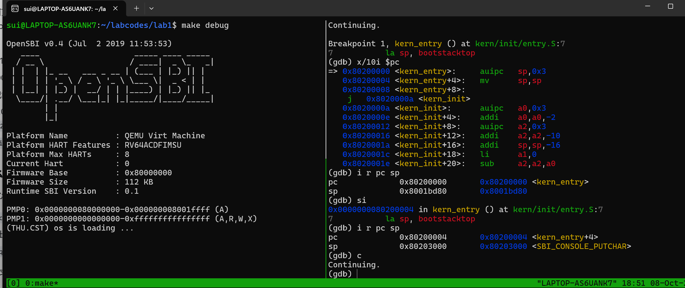

# 操作系统实验报告

## 实验基本信息

| 项目 | 内容 |
|------|------|
| **实验名称** | Lab 1: [比麻雀更小的麻雀（最小可执行内核）] |
| **小组成员** | 2411564-刘欣怡、2411846-鞠昀慧、2411690-白诗雨 |
| **完成日期** | 2026-10-9 |

### 小组分工

练习如何分工？

| 成员 | 负责的练习/模块 |
|------|----------------|
| 2411564-刘欣怡| [汇编入口与链接脚本分析（练习1）] |
| 2411846-鞠昀慧| [SBI底层调用与stdio输出链分析] |
| 2411690-白诗雨| [GDB启动流程验证（练习2）] |

实验报告如何分工？

本实验报告由小组成员共同完成。其中，刘欣怡负责“实验整体逻辑分析”与“练习1”的撰写，重点梳理了内核启动的逻辑主线，并深入分析了entry.S中汇编入口的操作；鞠昀慧负责“实验目的”、“实验环境”以及“SBI底层调用与stdio输出链”的说明，阐述了内核如何通过ecall陷入M模式调用OpenSBI实现输出；白诗雨负责“练习2”与“测试验证”部分，记录GDB调试的实操过程、寄存器变化观察结果，并负责测试截图的整理。“实验总结与收获”中的OS原理理解及AI协作感悟，则由三人共同商量讨论、提取核心观点之后汇总完成。

## 一、实验目的

<!-- 说明本次实验的主要目标和预期成果 -->

本实验的主要目的是：

1. 目的1：理解 RISC-V 硬件加电复位到操作系统内核启动的完整底层流程（加电 → MROM → OpenSBI → 内核入口）。
2. 目的2：掌握操作系统内核的编译、链接、加载过程，理解链接脚本 `kernel.ld` 如何规定内核内存布局，以及代码的“地址相关性”。
3. 目的3：熟悉 QEMU 和 GDB 的联合调试方法，能够跟踪从加电到跳转至 0x80200000 内核第一条指令的完整过程。
4. 目的4：理解操作系统内核如何通过 `ecall` 在 S 模式请求 M 模式的 OpenSBI 服务，构建最基础的 `cprintf` 输出功能。

---

## 二、实验环境

你们使用的 AI 工具

| 成员 | AI 编程工具 | 底层模型 | 备注 |
|------|------------|---------|------|
| 2411564-刘欣怡 | Claude Code | | DeepSeek-V4 | 
| 2411846-鞠昀慧 | DeepSeek | | DeepSeek-V4 |
| 2411690-白诗雨 | DeepSeek | | DeepSeek-V4 |

**说明：**
- **AI 编程工具**：实验基于 WSL2 (Ubuntu) + QEMU 4.1.1 + riscv64-unknown-elf-gdb 17.2 + GCC 16.1.0。
- **底层模型**：DeepSeek-V4

---

## 三、实验整体逻辑分析

### 3.1 本章节的逻辑主线

本章节的核心主线是最小可执行内核的构建与启动。
在 QEMU 模拟的 RISC-V 架构中，操作系统本身无法自行启动，必须依赖底层的固件和引导程序。整个实验围绕如何让一个操作系统内核在 RISC-V 裸机环境（QEMU 模拟）上跑起来进行展开，理解最小可执行内核启动过程，即：
1. **硬件初始化与固件启动阶段**（CPU加电，从0x1000开始执行MROM，MROM主要是完成最基本的环境准备，并将控制权交给OpenSBI。OpenSBI 被加载到物理内存的0x80000000处）。
2. **OPENSBI初始化与内核加载**（CPU跳转到0x80000000处继续运行，OpenSBI运行在M模式，初始化环境并将内核加载至0x80200000）。
3. **内核启动执行阶段**（OpenSBI跳转到0x80200000地址，开始执行kern/init/entry.S。在0x80200000这个地址上存放的是kern/init/entry.S文件编译后的机器码。entry.S设置内核栈指针，为C语言函数调用分配栈空间，准备C语言运行环境，然后按照RISC-V的调用约定跳转到kern_init()函数。最后，kern_init()调用cprintf()输出一行信息，表示内核启动成功）。

### 3.2 功能的逐步实现

1. **首先理解内核入口与内存布局（`entry.S` 和 `kernel.ld`）**  
   原因：内核必须被加载到固定的物理地址 0x80200000。kernel.ld 指定布局和入口符号，entry.S 建立栈指针，为 C 环境做准备。
2. **然后实现底层的字符输出（`sbi.c` 与 `console.c`）**  
   原因：内核需要可视化反馈，但此时没有任何标准库可用，必须从零构建 `cprintf`，输出通过 `ecall` 进入M模式，借助 OpenSBI 实现字符输出。
3. **最后完成内核C入口初始化（`kern_init`）**  
   原因：进入 C 语言环境后，需要清理 `.bss` 段，调用 cprintf 输出启动信息输出启动信息，进入死循环，从而完成最小可执行内核的闭环。
4. **接着使用 GDB 验证启动全过程**  
   原因：汇编代码编译出的是纯二进制（.bin）文件，必须通过 GDB 打断点、查寄存器和反汇编，才能验证从 0x1000 复位 → OpenSBI → 0x80200000 内核入口的整条链路符合预期。

## 四、实验内容与实现

### 练习1：理解内核启动中的程序入口操作

**负责人：** [2411564-刘欣怡]

#### 模块功能描述

entry.S 是整个内核的汇编入口文件，它承担着从 OpenSBI 交接后到进入 C 语言世界的关键桥梁作用。该文件整体实现了两个核心功能：建立内核栈和跳转到 C 语言入口函数。具体实现方式是：在 .text 段定义全局符号 kern_entry，作为内核的第一条指令地址；通过 la sp, bootstacktop 将栈指针设置为内核栈的栈顶；最后用 tail kern_init 直接跳转到 C 函数 kern_init。同时，在 .data 段中利用 .space KSTACKSIZE 预留一块静态内存作为内核栈，并用 bootstack 和 bootstacktop 两个符号分别标记栈底（低地址）和栈顶（高地址）。

本模块的任务是阅读 kern/init/entry.S内容代码，结合操作系统内核启动流程，说明指令 la sp, bootstacktop 完成了什么操作，目的是什么？ tail kern_init 完成了什么操作，目的是什么？

**需要阅读的函数节选：**

kern_entry:
    la sp, bootstacktop
    tail kern_init

**功能说明：**

1.la sp, bootstacktop 完成了什么操作，目的是什么？

完成的操作：la是load address伪指令，它的作用是将栈顶bootstacktop的绝对地址加载到sp寄存器中。其中，bootstack是一块KSTACKSIZE字节大的内存区域，而bootstacktop则是这块区域的栈顶，将栈顶地址加载到sp指针中，往内核栈压入数据时，sp会向低地址移动，但栈的使用量不会超过KSTACKSIZE字节，否则会发生溢出。

目的：初始化内核栈指针。因为 RISC-V 的栈从高地址向低地址增长，bootstacktop代表栈顶的高地址。此时sp被设为0x80203000，让 kern_init 及其调用的 memset、cprintf 等函数有合法的栈可用，能正常压栈、出栈。

2.tail kern_init 完成了什么操作，目的是什么？

完成的操作：tail是尾调用伪指令，被编译为 j 0x8020000a <kern_init>，即直接跳转到kern_init处，不保存返回地址。

目的：将CPU控制权从汇编代码转移给 C 语言入口函数 kern_init。由于 kern_init 声明了 __attribute__((noreturn))，它不会返回，因此不需要保存返回地址，直接用 tail 跳转即可。

### 练习2：使用GDB验证启动流程

**负责人：** [2411690-白诗雨]

#### 模块功能描述

本模块的核心任务是使用 GDB 联合 QEMU，动态追踪并验证 RISC-V 架构从硬件加电到内核第一条指令执行的完整底层流程。该模块的整体实现方式依赖于 QEMU 和 GDB 的远程调试机制：首先在终端 A 执行 make debug，通过 -S 参数让 CPU 在上电后暂停执行，并通过 -s 参数监听本地 1234 端口；接着在终端 B 执行 make gdb，加载包含调试符号的内核 ELF 文件并连接到 QEMU。连接成功后，利用 x/10i $pc 反汇编查看复位地址处的 MROM 指令，利用 b *0x80200000 在内核入口处设置断点，利用 c 继续运行，利用 i r pc sp 查看寄存器状态，利用 si 单步执行汇编指令。通过观察 PC 和 SP 寄存器的变化，最终验证了从固件到内核的控制权交接，以及内核栈的建立过程。

通过调试，请思考并回答：RISC-V 硬件加电后最初执行的几条指令位于什么地址？它们主要完成了哪些功能？

**调试过程与观察结果：**

1.在终端A执行 make debug，启动 QEMU 并利用 -S -s 参数让 CPU 在上电时暂停并监听 1234 端口。在终端B执行 make gdb，加载内核 ELF 文件并连接至 QEMU。

连接成功后，GDB 显示 PC 位于 0x0000000000001000。执行 x/10i $pc，观察到 MROM 固件的底层指令。

2.执行 b *0x80200000 并输入 c 继续运行，程序跳过 OpenSBI 执行区，命中内核入口断点。

3.执行 i r pc sp，观察到 pc = 0x80200000，此时 sp = 0x8001bd80（OpenSBI 遗留的旧栈指针）。

4.执行 si 单步执行一条指令（即 la sp, bootstacktop 的第一条 auipc 指令），再次执行 i r pc sp，发现 pc = 0x80200004，sp = 0x80203000（成功切换至内核栈顶）。

5.输入 c 继续运行，QEMU 终端输出 (THU.CST) os is loading ...。

#### 问题回答：

1.RISC-V 硬件加电后最初执行的几条指令位于什么地址？

位于 0x1000。QEMU 模拟的 RISC-V 处理器复位后，PC 被硬件强制初始化为 0x1000（复位向量地址）。

2.它们主要完成了哪些功能？

它们属于 QEMU 内置的 MROM 代码，主要进行最基础的硬件初始化准备。随后将控制权移交至 0x80000000 的 OpenSBI 固件，由 OpenSBI 完成更完整的机器态初始化，并负责将 ucore 内核镜像加载至 0x80200000，最后跳转过去执行。

### Challenge：[OPENSBI底层调用与stdio输出链分析]

**负责人：** [2411846-鞠昀慧]

#### 模块功能描述

内核启动后需要输出 (THU.CST) os is loading ... 信息。由于此时没有操作系统和标准库，无法使用 printf，内核必须通过 OpenSBI 提供的底层服务，按字符输出。

#### 核心调用链：

cprintf → cputs → cputch → cons_putc → sbi_console_putchar → sbi_call → ecall

#### 核心函数与实现原理：

在 libs/sbi.c 中，sbi_call 通过 C 语言内联汇编（__asm__ volatile）实现了对 SBI 服务的调用。

汇编代码严格遵守 RISC-V 调用约定：将功能编号（如 SBI_CONSOLE_PUTCHAR = 1）放入 a7 寄存器，将参数（如字符的 ASCII 码）放入 a0 寄存器，然后执行 ecall 指令。

ecall 会使 CPU 从 S 模式陷入 M 模式，由 OpenSBI 处理请求。处理完成后，返回值会被存入 a0，CPU 切回 S 模式继续执行。

## 五、测试与验证

**测试截图：**

“截图左侧为 QEMU 运行输出，右侧为 GDB 调试过程。”

**截图分析：**

该截图完整记录了使用 GDB 验证内核启动流程的核心过程：

1.初始状态：GDB 连接 QEMU 后，PC 停在 0x1000，证实硬件加电后从复位地址执行 MROM 固件。

2.命中内核入口：在 0x80200000 处设置断点并继续执行，成功命中 kern_entry。

3.反汇编验证：x/10i $pc 显示，la sp, bootstacktop 被展开为 auipc sp,0x3 和 mv sp,sp 两条机器指令；tail kern_init 被展开为直接跳转 j 0x8020000a。

4.核心证据（栈切换）：

执行 si 前：sp = 0x8001bd80，这是 OpenSBI 遗留的旧栈指针。

执行 si 后：sp = 0x80203000，成功切换为 ucore 的内核栈顶（即 bootstacktop）。

5.最终结果：继续运行后，QEMU 输出 (THU.CST) os is loading ...，证明内核 C 入口及 SBI 输出链正常工作。

## 六、实验总结与收获

### 对操作系统的理解

1. 在本实验中，我们接触到了许多与操作系统底层密切相关的核心知识点。具体如下：

链接脚本 kernel.ld 与 0x80200000 加载地址的规定，直接对应了 OS 原理中“程序的编译、链接与内存布局”这一知识点。二者的关系在于，链接脚本决定了程序各个段（如 .text、.data）在内存中的绝对物理地址；而差异在于，普通用户态程序通常由操作系统通过虚拟内存动态分配地址，而内核作为最底层的软件，必须被静态加载到固定的物理地址，这也正是本实验中“地址相关代码”概念的由来。

entry.S 中 la sp, bootstacktop 初始化栈的操作，对应了 OS 原理中的“函数调用栈”机制。它们的关系是，C 语言函数调用的基础就是栈，因此必须在进入 C 代码前设置好 sp；差异在于，用户态进程的栈由操作系统统一分配和管理，而内核启动初期处于“裸机”状态，必须在汇编中手动开辟一块静态内存作为栈。

sbi.c 中通过 ecall 陷入 M 模式请求 OpenSBI 服务的机制，对应了 OS 原理中“系统调用”的底层逻辑。二者都是通过 ecall 指令触发异常切换特权级，但差异在于：用户程序是通过 ecall 从 U 模式陷入 S 模式调用内核，而内核自身则是通过 ecall 从 S 模式陷入 M 模式调用固件。

关于“地址相关代码”与“地址无关代码（PIC）及重定位”的对比，其关系在于代码中的访存指令是否直接编码了绝对地址，差异则体现在现代操作系统大量使用动态链接和虚拟内存来实现地址无关性，而本实验为了降低复杂度，直接将内核固定在 0x80200000 处执行。

2. OS 原理中还有很多非常重要的知识点在本章中并未涉及。比如：

进程管理与调度，本实验的内核最终只进入了一个 while(1) 死循环，没有创建任何进程或线程，自然也谈不上调度算法的实现；

虚拟内存与分页机制，内核目前完全直接使用物理地址，既没有建立页表，也没有开启 MMU（RISC-V 的 satp 寄存器未启用），无法实现虚拟地址到物理地址的转换；

文件系统与设备驱动，除了通过 SBI 实现的简单控制台输出外，未涉及任何磁盘读写或文件抽象；

中断与异常处理，除了 ecall 会陷入 M 模式外，内核并没有建立自己的中断向量表（stvec），无法处理时钟中断、缺页异常等底层事件。

### AI 协作开发的经验

在本实验中，AI 工具起到了“底层翻译官”的作用。由于我们是初次接触 RISC-V 汇编，对于 很多符号感到非常陌生。通过向 AI 提问，我们快速理解了“伪指令是在汇编阶段被展开为多条真实机器指令”这一机制。。但我们也意识到，AI 只能辅助理解，AI有时会给出不准确的寄存器解释或伪指令展开。真正的寄存器状态变化和启动流程，必须由我们亲手在 GDB 中单步执行，只有亲眼看到了sp 的值从 0x8001bd80 变为 0x80203000 才能深刻掌握。

