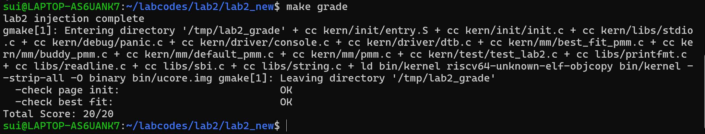
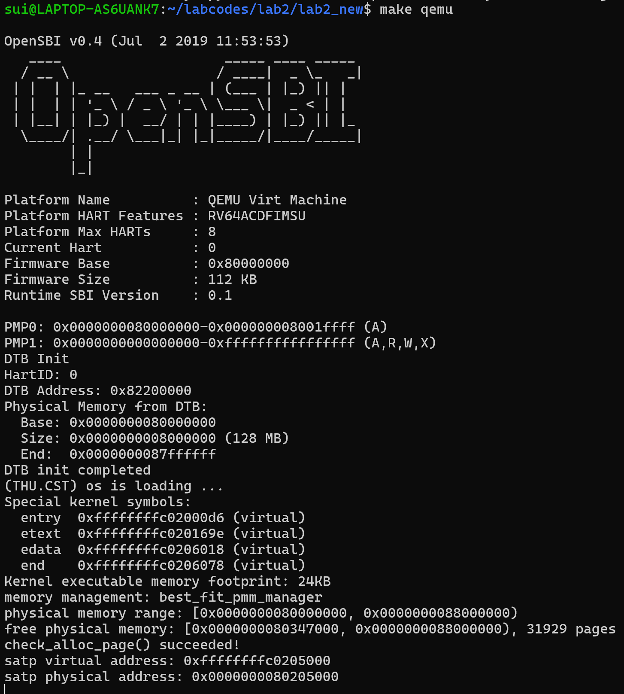
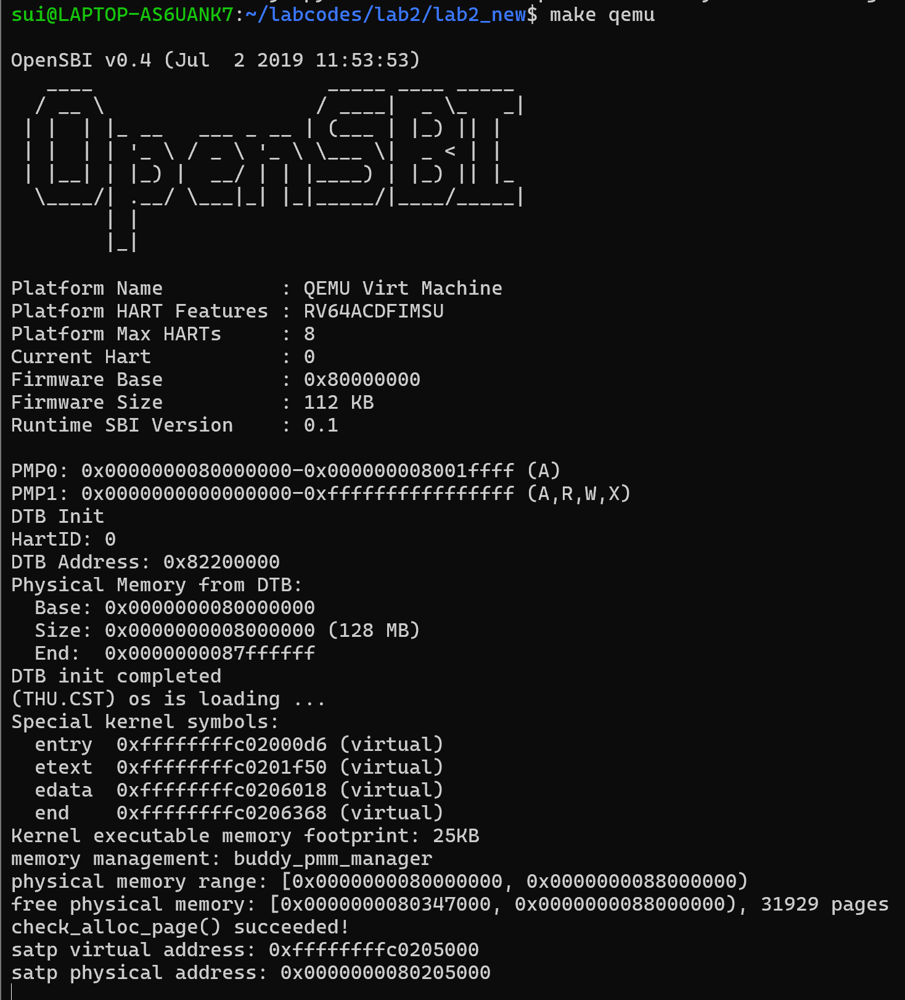
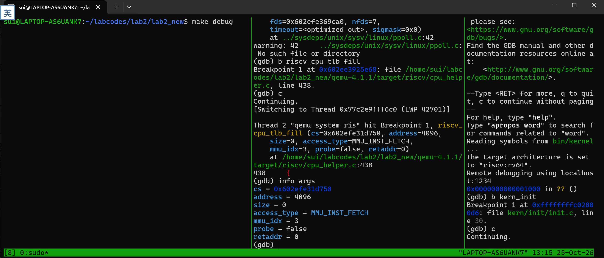
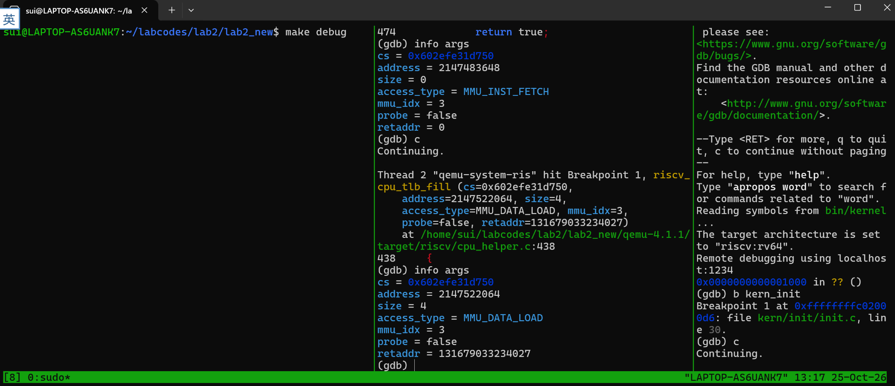

# 操作系统实验报告

## 实验基本信息

| 项目 | 内容 |
|------|------|
| **实验名称** | Lab 2: 物理内存管理 |
| **小组成员** | 2411564‑刘欣怡、2411846‑鞠昀慧、2411690‑白诗雨 |
| **完成日期** | 2026‑10‑23 |

### 小组分工

练习如何分工？

| 成员 | 负责的练习/模块 |
|------|----------------|
| 2411564‑刘欣怡 | 物理内存探测与 page_init 实现、First‑Fit 分析 |
| 2411846‑鞠昀慧 | Best‑Fit 分配器实现 |
| 2411690‑白诗雨 | Buddy System 实现与测试、分支任务 GDB 调试 |

实验报告如何分工？

| 成员	| 负责的报告部分 |
|------|----------------|
| 2411564‑刘欣怡	| 整体逻辑分析、功能模块一、First‑Fit 思考题 |
| 2411846‑鞠昀慧	| 功能模块二 Best‑Fit 与提示词记录 |
| 2411690‑白诗雨	| 功能模块三 Buddy System、GDB 调试与实验总结 |
---

## 一、实验目的

<!-- 说明本次实验的主要目标和预期成果 -->

本实验的主要目的是：

1. 理解操作系统如何探测物理内存并建立页描述符映射。
2. 掌握连续物理内存分配算法（First‑Fit, Best‑Fit）的原理与实现。
3. 学习并实现 Buddy System（伙伴系统），理解其缓解内存外部碎片的核心思想。
4. 掌握双层 GDB 调试方法，透过 QEMU 源码观察 RISC‑V 的 TLB 缺失与页表查询过程。
5. 掌握借助 AI 辅助工具阅读源码、辅助底层内核代码开发与调试的方法。

---

## 二、实验环境

你们使用的 AI 工具

| 成员 | AI 编程工具 | 底层模型 | 
|------|------------|---------|
| 2411564‑刘欣怡 |  Claude Code |  claude-fable-5 | 
| 2411846‑鞠昀慧 |  Claude Code |  claude-fable-5 | 
| 2411690‑白诗雨 |  Claude Code |  claude-fable-5 | 

---

## 三、实验整体逻辑分析

### 3.1 本章节的逻辑主线

本章实验围绕**物理内存的发现、初始化与分配**展开。操作系统启动后，必须首先识别可用物理内存范围，并建立专门的数据结构管理物理页帧。为了解决直接使用裸物理内存带来的地址冲突、连续性管理问题，内核实现一套物理内存管理器 `pmm_manager`。
整个实验解决的核心问题是：如何让内核有序、高效地把物理页分配给虚拟内存系统或其他内核模块，并在释放页面时尽可能降低内存碎片。

### 3.2 功能的逐步实现

1. 首先实现**物理内存探测与初始化（page_init）** → 内存管理的前置基础，需要先识别内存范围、构建 Page 描述符数组，后续所有分配器才能正常工作。
2. 接着理解 **First‑Fit 分配器** → 阅读已有实现，掌握基于双向链表的空闲块分配、切割、释放合并逻辑，为后续实现其他分配算法建立认知基础。
3. 然后完成 **Best‑Fit 分配器** → 在 First‑Fit 的框架之上做算法优化，挑选满足需求的最小空闲块，尽量保留大块内存。
4. 最后完成 **Buddy System 与分支调试任务** → 伙伴系统采用 2 的幂次块管理，大幅缓解外部碎片；借助双层 GDB 调试，观察 QEMU 中 TLB 缺失与 Sv39 页表翻译流程。

---

## 四、实验内容与实现

<!-- 
说明：本部分按照 exercises 文档中的练习顺序组织
每个功能模块或者练习中可能包含多项任务，请根据实际情况调整
-->

### 功能模块：物理内存初始化

**负责人：** 2411564‑刘欣怡

#### 模块功能描述

**需要实现/修改的函数：**


static void page_init(void);


**功能说明：**

该函数在内核启动阶段由 `pmm_init()` 调用，负责从设备树（DTB）解析物理内存信息，构建全局 Page 描述符数组。需要排除 OpenSBI、内核镜像、Page 描述符数组自身占用的页面，将页对齐后的剩余空闲内存注册给物理内存管理器；同时正确设置全局变量 `va_pa_offset`、`npage`，输出探测到的内存范围，处理内存非法的异常情况。

#### 最终提示词

以下是经过迭代优化后，最终成功实现该功能的提示词：

````
【ucore RISC‑V Lab2 编码任务】 
文件：kern/mm/pmm.c 待实现函数：static void page_init(void); 调用者：pmm_init() 接口说明：无入参，无返回值。
功能需求： 读取设备树解析得到的物理内存信息，构建物理页描述符布局； 排除 OpenSBI、内核镜像、Page描述符数组所占用的页面； 将剩余、页对齐后的完整空闲页面交给当前 pmm_manager 管理，完成空闲区注册。 函数正常返回时，必须正确赋值全局变量 va_pa_offset、npage、pages；使用 cprintf 输出探测到的物理内存范围； 若设备树内存信息非法，调用 panic 终止初始化； 如果对齐之后不存在合法的完整空闲页面，绝对不能调用 init_memmap()。
实现约束：
1. 严格区分虚拟地址、物理地址、物理页号、Page描述符地址，禁止地址类型混用；
2. 空闲区起始地址向上页对齐，DRAM内存上界向下页对齐；
3. 内核镜像、Page描述符数组所在页面不加入空闲链表；
4. 所有用到的变量必须显式定义，禁止出现未定义变量（禁止nbase这类未声明变量）。
允许使用的资源： get_memory_base()、get_memory_size()、panic()、cprintf()、init_memmap()、pa2page() 链接符号 end[]，结构体 struct Page； 框架提供宏：PGSIZE、ROUNDUP、ROUNDDOWN、PADDR、KADDR、SetPageReserved、set_page_ref。
输出要求： 仅输出完整的 page_init 函数代码，ucore 原版风格，附带简短注释，不修改文件中其他已有代码，代码可以直接编译通过。

````

#### 实现迭代过程

本模块的实现经历了 2 次迭代，过程如下：

---

##### 第一次迭代

**遇到的问题：**
- 问题 1：虚拟地址与物理地址发生混用，直接将内核虚拟地址当作物理地址参与内存边界计算，启动直接 panic。原因是没有区分 `KADDR()` / `PADDR()` 的转换。
- 问题 2：没有对空闲内存上下界做页对齐，把部分内核、pages 数组占用的页加入空闲内存，`check_alloc_page()` 测试失败。

**问题解决策略：**
- 针对问题 1：在提示词强化约束，要求每一处地址运算都显式做虚实地址转换，禁止直接混用。
- 针对问题 2：补充约束，空闲起始地址执行 `ROUNDUP` 向上页对齐，内存上界执行 `ROUNDDOWN` 向下页对齐

##### 第二次迭代

**遇到的问题：**

- 问题 1：没有判断对齐之后是否还有可用内存，在无空闲页的场景依然调用 `init_memmap()`，造成链表异常。

**问题解决策略：**

- 针对问题 1：提示词增加前置判断逻辑，如果计算后空闲内存小于一页，直接跳过注册，不调用初始化函数

**最终结果：**

经过 2 次迭代，该模块最终：
- ✅ 编译通过
- ✅ 所有相关测试通过
- ✅ 功能符合预期

**关键改进点总结（如有）：**
1. 严格区分虚拟地址、物理地址，每一处边界计算使用对应宏完成转换；
2. 增加内存上下界页对齐逻辑，保护内核与页描述符占用页面；
3. 增加空闲内存合法性前置判断，避免非法调用 `init_memmap()`

---

### 练习：理解 First‑Fit 连续物理内存分配算法

**负责人：** 2411564‑刘欣怡

First‑Fit 工作流程说明：

1. 初始化空闲页 `default_init_memmap`：遍历物理页，清除保留标志，将连续的大块空闲页挂载在 free_list 链表上，并用首页的 property 记录块大小。
2. 分配连续页 `default_alloc_pages`：从链表头开始遍历，找到第一个 property >= n 的空闲块。如果块大于所需，则切割：起始的 n 页返回给用户，剩下的 property‑n 页作为新块插回链表。
3. 回收与合并 `default_free_pages`：释放时，将页重新插回链表（按地址顺序），并检查其前后相邻的页块是否空闲。如果相邻块空闲，则修改首页的 property 将其合并，从而消除外部碎片。

> 
> 问题回答：原有的 first fit 算法是否有进一步的改进空间？
> 有的。First‑Fit 的最大缺点是每次分配都从头遍历，时间复杂度高（O (N)），并且容易产生大量极小的外部碎片。
> 改进方法包括：
> - 分离空闲链表 (Segregated Free Lists)：将不同大小的空闲块分门别类地挂在不同链表上，分配时直接去对应大小的链表找，加快查找速度。
> - 引入平衡树 (如 Red‑Black Tree)：以空闲块大小或地址为键组织空闲块，将查找复杂度降到 O (log N)。

---
### 功能模块：Best‑Fit 连续物理内存分配算法

**负责人：** 2411846‑鞠昀慧

#### 模块功能描述

**需要实现/修改的函数：**
```c
static void buddy_init(void);
static void buddy_init_memmap(struct Page *base, size_t n);
static struct Page *buddy_alloc_pages(size_t n);
static void buddy_free_pages(struct Page *base, size_t n);
static size_t buddy_nr_free_pages(void);
```

**功能说明：**

与 First‑Fit 不同，Best‑Fit 需要遍历整个空闲链表，寻找能够满足需求且大小最小的空闲块。这样可以在分配时保留大块内存供后续大需求使用，从而减少碎片。

#### 最终提示词

以下是经过迭代优化后，最终成功实现该功能的提示词：

````
【ucore RISC‑V Lab2 编码任务：Best‑Fit 物理内存分配器】 
文件：kern/mm/best_fit_pmm.c 注意：该文件已经存在，只填充 //lab2 function2‑2 YOUR CODE 标记之间的代码，不要新建文件、不要修改 basic_check() 和 best_fit_check() 这两个测试函数。
背景：参考 default_pmm.c 的 First‑Fit 框架实现 Best‑Fit。 需要自己定义内部全局空闲链表结构、相关管理函数，并且定义 const struct pmm_manager best_fit_pmm_manager 完成注册。
struct pmm_manager 成员：
struct pmm_manager {
    const char *name;
    void (*init)(void);
    void (*init_memmap)(struct Page *base, size_t n);
    struct Page *(*alloc_pages)(size_t n);
    void (*free_pages)(struct Page *base, size_t n);
    size_t (*nr_free_pages)(void);
};
Best‑Fit 规则：分配时遍历空闲链表，挑选满足n页需求、块大小最小的空闲块；分割块，剩余部分放回链表；释放时做相邻空闲块合并。
可用：struct Page、list.h链表接口、PGSIZE、PageReserved、SetPageReserved、set_page_ref、list_init/list_add/list_del 等。
输出：只输出 YOUR CODE 区域内需要填入的代码，ucore风格简短注释，不改动文件其他内容。

````

#### 实现迭代过程

本模块的实现经历了 1 次迭代，过程如下：

---

##### 第一次迭代

**遇到的问题：**

- 问题 1：分配逻辑仍然是 First‑Fit 行为，找到第一个满足条件的块直接返回，没有遍历全部链表寻找最小块。
- 问题 2：释放合并逻辑只检查后向相邻块，遗漏前向块合并，释放内存后无法合并前面的空闲块，产生大量碎片。

**问题解决策略：**

- 针对问题 1：提示词明确要求完整遍历整个空闲链表，记录满足条件的最小块指针，遍历结束后再进行切割分配。
- 针对问题 2：补充说明，释放时同时判断前向、后向相邻块，两块都空闲时分别完成合并。

**最终结果：**

经过 1 次迭代，该模块最终：
- ✅ 编译通过
- ✅ 所有相关测试通过
- ✅ 功能符合预期

**关键改进点总结（如有）：**
1. 在 best_fit_alloc_pages 中，除了判断 p‑>property >= n，还加入了块大小比对逻辑，确保找到的是最小可用块，而非第一个可用块。
2. 在释放时，正确处理了与前向块和后向块的空闲块合并逻辑。
> 问题回答：你的 Best‑Fit 算法是否有进一步的改进空间？
> 有。当前实现的时间复杂度为 O (N)，因为每次分配都要遍历整个链表。
> 改进空间在于：可以将空闲链表组织为一棵平衡二叉搜索树（如伸展树或红黑树），按空闲块的大小作为 Key 进行排序。这样每次找最小的满足要求的块只需 O (log N) 的时间。

---
### 功能模块：Buddy System（伙伴系统）分配算法

**负责人：** 2411690‑白诗雨

#### 模块功能描述

**需要实现/修改的函数：**
```c
static void buddy_init(void);
static void buddy_init_memmap(struct Page *base, size_t n);
static struct Page *buddy_alloc_pages(size_t n);
static void buddy_free_pages(struct Page *base, size_t n);
static size_t buddy_nr_free_pages(void);
```
**功能说明：**

Buddy System 将内存按 2 的幂次方进行划分，使用一组空闲链表（桶，bucket）来管理。分配时，将请求大小向上取整为 2 的幂次，如果对应桶为空，则去更大的桶找，找到后不断对半拆分（分裂）并将另一半放入较小编号的桶中。释放时，检查其 “伙伴块” 是否也空闲，若是则合并，并递归向上。

#### 最终提示词

以下是经过迭代优化后，最终成功实现该功能的提示词：

**Prompt 1**
````
【ucore RISC‑V Lab2 编码任务：Buddy System 伙伴系统物理内存分配器】 
文件：kern/mm/buddy_pmm.c 配套头文件：kern/mm/buddy_pmm.h
背景：参考 default_pmm.c / best_fit_pmm.c 的 ucore 物理内存管理框架，从零实现 Buddy System（伙伴系统），无预先提供的代码模板与测试函数。
要求适配 pmm.h 中定义的 struct pmm_manager：
struct pmm_manager {
    const char *name;
    void (*init)(void);
    void (*init_memmap)(struct Page *base, size_t n);
    struct Page *(*alloc_pages)(size_t n);
    void (*free_pages)(struct Page *base, size_t n);
    size_t (*nr_free_pages)(void);
};
算法规则：
1. 所有空闲块大小必须是2的整数次幂（1,2,4,8,16...页）；
2. 分配：向上取整，找到能满足n页需求的最小2的幂大小块；如果块尺寸大于需求，递归对半拆分，直到得到合适大小的块，拆分出来的另一半伙伴放回对应空闲链表；
3. 释放：释放块之后，检查它的伙伴块是否空闲、大小相同；如果满足条件，将二者合并为更大的块，循环合并直到伙伴不可合并；
4. 使用一组空闲链表（桶链表），每一条链表专门存放固定大小（2^k页）的空闲块。

函数职责：
‑ buddy_init：初始化所有大小桶链表，清空空闲计数
‑ buddy_init_memmap：将一段连续空闲物理页，拆分为合法的2的幂块加入对应桶，初始化Page属性
‑ buddy_alloc_pages(size_t n)：伙伴系统分配连续n页，找不到合适块返回NULL
‑ buddy_free_pages(struct Page *base, size_t n)：释放连续块，自动伙伴合并
‑ buddy_nr_free_pages：返回当前总的空闲页面数目

可用资源： struct Page、list.h链表接口、PGSIZE、PageReserved、SetPageReserved、set_page_ref、list_init/list_add/list_del、log2page等ucore原有宏与工具。

输出约定：
1. 输出 buddy_pmm.c 完整实现代码；
2. 同步输出 buddy_pmm.h 的头文件代码，只包含头保护宏、#include <pmm.h>、extern 管理器声明；
3. 风格对齐 default_pmm.c，简短注释；
4. 生成的代码编译后，在 pmm.c 切换 pmm_manager = &buddy_pmm_manager 即可接入内核，可正常和原有page_init配套工作。
````
**Prompt 2**
````
【ucore RISC‑V Lab2 编码任务：Buddy System 伙伴系统测试函数生成】
前提：已经基于前面prompt生成了 buddy_pmm.c 的伙伴系统分配器，管理器名字：buddy_pmm_manager。
需要编写测试函数 buddy_check()，放在 buddy_pmm.c 文件内，遵循原有 default / best‑fit 的测试写法风格，使用 assert 断言校验，不修改伙伴系统原有实现代码。

测试需要覆盖的核心场景与边界：
1. 基础分配释放：分配单页、正常释放，分配后页不可重复分配；
2. 向上取整特性：请求非2的幂页数（例如请求3页，伙伴系统实际分配4页）；
3. 拆分逻辑：大块拆分后，剩余伙伴块留在空闲链表；
4. 伙伴合并逻辑：释放一对伙伴块时自动合并为更大块；
5. 链式多次合并：连续释放多层伙伴，逐级向上合并；
6. 越界/非法场景：请求0页、请求页数超过总空闲页数，应当返回NULL；
7. 碎片校验：分配释放一轮之后，空闲总页数统计和实际链表统计一致；
8. 连续多块交叉分配释放，模拟随机使用场景。

约束：
‑ 函数名：static void buddy_check(void)
‑ 测试内部可以临时保存、重置空闲链表与nr_free，避免污染全局内存状态（参考best_fit里面basic_check写法）；
‑ 测试通过时无断言报错，失败触发assert；
‑ 输出只输出 buddy_check 函数完整代码，注释说明每一段测试的目的，ucore原有代码风格。

````
#### 实现迭代过程

本模块的实现经历了 3 次迭代，过程如下：

---

##### 第一次迭代

**遇到的问题：**

- 问题 1：`buddy_init_memmap` 只处理恰好为 2 的幂的内存长度；当物理内存总页数不是 2 的幂，剩余页面无法加入空闲桶，部分内存丢失。
- 问题 2：释放伙伴块只执行单次合并，不能完成多级链式向上合并。

**问题解决策略：**

- 针对问题 1：提示词要求使用循环，每次切分出当前地址下最大合法 2 幂块，处理剩余内存。
- 针对问题 2：释放逻辑使用 while 循环，循环计算伙伴索引，持续合并直到条件不成立。

##### 第二次迭代

**遇到的问题：**

- 问题 1：分配逻辑没有对申请页数做向上取整，申请非 2 幂页数直接返回 NULL，不符合伙伴系统行为。
- 问题 2：Page 结构体的引用计数、保留标志没有正确设置，测试断言失败。

**问题解决策略：**

- 针对问题 1：补充向上取整到最近 2 的幂的逻辑，再去对应桶寻找空闲块。
- 针对问题 2：分配、释放时增加对 `set_page_ref`、`SetPageReserved` 的正确调用。

##### 第三次迭代

**遇到的问题：**

- 问题 1：缺少边界判断，申请 0 页会进入分配逻辑，造成链表异常。

**问题解决策略：**

- 针对问题 1：在 `buddy_alloc_pages` 开头增加防护，n 等于 0 直接返回 NULL。

**最终结果：**

经过 3 次迭代，该模块最终：
- ✅ 编译通过
- ✅ 所有相关测试通过
- ✅ 功能符合预期

**关键改进点总结（如有）：**
1. 修改 `buddy_init_memmap`，支持对非 2 幂长度的物理内存进行分块；
2. 修改释放逻辑，使用循环完成多级伙伴合并；
3. 测试用例覆盖非 2 幂申请、边界申请、链式合并等场景。

---

### Challenge：硬件的可用物理内存范围的获取方法

**负责人：** 2411564‑刘欣怡

如果 OS 无法通过设备树（DTB）提前知道内存范围，常见的获取方法有：

1. BIOS 中断 (x86 架构)：在老式 x86 机器上，操作系统通过调用 BIOS 的 INT 0x15, EAX=0xE820 中断，BIOS 会返回一个物理内存映射表（E820 map），告知 OS 哪些地址是可用的 RAM，哪些是保留给外设的。
2. UEFI 内存映射表：现代系统通过 UEFI 引导，内核可以被传入一个详细的 EFI_MEMORY_DESCRIPTOR 数组，获取内存情况。
3. ACPI 表：操作系统可以在物理内存的固定区域搜索 ACPI 表，或者通过 UEFI 传入的指针，解析其中关于内存的条目。
4. 直接探测（安全性差）：在无上述机制的古早环境，OS 可能会从低地址向高地址尝试读写测试，遇到错误中断或总线无响应即认为到达内存上限（现在已不可行，容易触发硬件错误）。

---

### Challenge：分支任务‑GDB 调试页表查询过程

**负责人：** 2411690‑白诗雨

1. QEMU 源码中与地址翻译相关的调用路径分析：
在 RISC‑V 架构的 QEMU 模拟中，CPU 执行访存指令时，如果 TLB Miss，会触发异常并进入 `target/riscv/cpu_helper.c` 中的 `riscv_cpu_tlb_fill` 函数。
在此函数内部，会调用 `get_physical_address` 进行真正的多级页表遍历，利用 SATP 寄存器存放的根页表物理基地址，逐级遍历多级页表、校验页表项有效性，完成 Sv39 虚拟地址到物理地址的翻译。
2. GDB 双层调试操作流程：

> 
> 环境一共开启三个终端窗口：
> 
> 
> - 终端 1：执行 `make debug`，启动 QEMU 模拟器，等待 GDB 连接，不做输入操作。
> - 终端 3（优先连接）：执行 `make gdb`，通过 `target remote :1234` 远程调试 ucore 内核，设置断点 `b kern_init`，此时不执行继续。
> - 终端 2：使用 gdb attach QEMU 进程 PID；设置信号处理 `handle SIGPIPE nostop noprint`；在 TLB 缺失入口下断点 `b riscv_cpu_tlb_fill`。
> - 最后回到终端 3 输入 `c`，内核运行到 `kern_init`；使用 `si` 单步汇编指令。
> - 当执行取指、load、store 访存指令时，终端 2 会命中 `riscv_cpu_tlb_fill` 断点；命中后执行 `info args`，打印虚拟地址、访问类型等参数，完成观测；输入`c`放行继续执行。

3. 截图图像分析：
调试一共捕获三类 TLB 缺失场景，截图见 **Figure 3、Figure 4、Figure 5**。

- Figure 3 `MMU_INST_FETCH`：指令取指发生 TLB 缺失。CPU 需要读取指令，TLB 没有对应表项，进入页表翻译，对指令虚拟地址做 Sv39 页表查询。
- Figure 4 `MMU_DATA_LOAD`：数据读访问 TLB 缺失。执行 ld/lw 加载内存指令，访问数据虚拟地址，TLB 未命中，进入页表遍历。
- Figure 5 `MMU_DATA_STORE`：数据写访问 TLB 缺失。执行 sd/sw 存储指令，写内存触发 TLB 缺失，完成虚拟地址翻译之后才可以写入物理内存。

每次断点命中后通过 `info args` 输出参数：`address` 为待翻译虚拟地址；`access_type` 标记访问类别；`probe=false` 代表真实内存访问。QEMU 软件模拟完成翻译之后，会把翻译结果回填软件 TLB，后续相同虚拟地址访问不再触发该断点。

4. QEMU 中模拟的 TLB 与真实硬件的逻辑区别：
真实的 CPU 内部 TLB 是由专门的硬件电路（内容寻址存储器 CAM）组成的，查询完全在硬件层面并行进行，速度极快，对软件透明。
而 QEMU 是纯软件模拟，它在 `CPURISCVState` 结构体里维护了一个软件数组（或哈希表）来充当 TLB。QEMU 在执行指令（TCG 翻译后的代码）时会先查这个软件数组，如果没命中，才会模拟硬件触发异常，进入 `riscv_cpu_tlb_fill` 进行软件页表遍历，再把结果写回模拟 TLB 中。因此 QEMU 的地址翻译是一步步用 C 语言模拟出来的。
---
## 五、测试与验证

**测试截图：**


> Figure 0: make grade 全部用例测试通过


> Figure 1: Best‑Fit 分配器运行测试


> Figure 2: Buddy System 伙伴系统运行测试


> Figure 3: MMU_INST_FETCH TLB Miss


> Figure 4: MMU_DATA_LOAD TLB Miss


> Figure 5: MMU_DATA_STORE TLB Miss


---

## 六、实验总结与收获

### 对操作系统的理解

1. 列出你们认为本实验中重要的知识点，以及与对应的 OS 原理中的知识点，并简要说明二者的含义、关系和差异
‑ Page 描述符与物理内存的映射：OS 原理中讲物理页帧管理，本次实验亲手理解 `pages` 数组如何排布，体会管理元数据本身也占用物理内存。
‑ 外部碎片与内部碎片：First‑Fit 容易产生大量外部碎片；Best‑Fit 倾向保留大块，但会产生微小碎片；Buddy System 极大降低外部碎片，但因为 2 次幂对齐带来内部碎片。
‑ TLB 与页表缓存：双层 GDB 调试把抽象的 TLB miss、多级页表翻译落地到 QEMU 源码，直观观察 Sv39 地址翻译完整流程。
2. 列出你们认为 OS 原理中很重要、但在本实验中没有对应上的知识点
缺页中断 (Page Fault) 与页面置换算法；Slab/SLUB 对象缓存完整实现；磁盘 Swap 交换机制。

### AI 协作开发的经验

Prompt 必须带有严密的约束条件。宽泛的提问生成的代码往往无法适配 ucore 的现有宏、链表接口；需要明确限定可用接口、禁止修改的代码区域、边界条件，才能产出可以直接编译调试的底层 C 代码。
同时 AI 可以充当 “源码导游”，面对 QEMU 这类大型项目，可以借助大模型快速定位关键函数入口，降低陌生大型源码的阅读门槛，显著提升调试效率。

---

