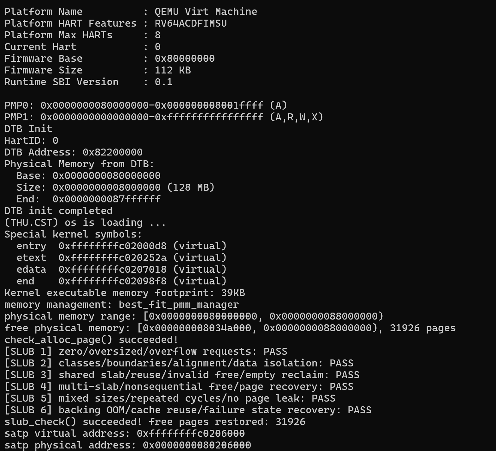

# 从打开Ubuntu开始获取报告截图

## 需要哪些图片

补充包images中已有六张原图：best_fit_qemu.png、buddy_qemu.png、grade_success.png、gdb_fetch.png、gdb_load.png、gdb_store.png，保留即可。后三张只说明初步访问类型，不能当作个人S态Sv39查表证据。

现在建议新增三张：slub_best_fit.png、slub_buddy.png、grade_after_slub.png。文本结果已通过，此处重复运行仅为采集图片，不是要求再证明一次。

## 1. 打开Ubuntu并进入项目

Windows按Win，输入Ubuntu，打开你平时使用的Ubuntu应用。

```bash
cd ~/os_group_submit/OS--lab2/code
```

```bash
export PATH="$HOME/opt/qemu-4.1.1/bin:$PATH"
```

```bash
hash -r
```

```bash
qemu-system-riscv64 --version
```

应显示4.1.1。若不是，先停止并反馈，不切换到系统8.2。若有旧QEMU，在其窗口按Ctrl+A、松开后按X退出；GDB在其窗口Ctrl+C后detach、quit。不要直接杀所有同名进程。

## 2. 获取Best-Fit + SLUB截图

```bash
make qemu-slub
```

等六项PASS出现。窗口最大化，必要时按Ctrl+-缩小字体或向上滚动，让截图至少包含：best_fit_pmm_manager、Free pages、SLUB 1～6 PASS、slub_check succeeded和恢复页数。当前构建已实测31926，若代码或编译配置改变数字可能变化，以本轮输出为准。

Windows按Win+Shift+S，框选终端结果，点击截图通知，保存为slub_best_fit.png。不要只截OpenSBI横幅。

退出QEMU：按Ctrl+A，松开后按X。

## 3. 获取Buddy + SLUB截图

```bash
make qemu-slub-buddy
```

等输出完成。截图包含buddy_pmm_manager、check_alloc_page成功、SLUB 1～6 PASS、最终恢复页数。最终组构建已实测31925。按Win+Shift+S截图，保存为slub_buddy.png。若一屏放不下可缩小字体，或两张图分别保存slub_buddy_1.png、slub_buddy_2.png，不拼造输出。

按Ctrl+A，松开后按X退出。

## 4. 获取评分截图

```bash
make grade
```

等显示Page Init OK、Best-Fit OK、Total Score 20/20，截图保存为grade_after_slub.png。这一评分不包含SLUB。

## 5. 放置图片和报告

下载最新版完整包并解压到Windows文件夹，例如桌面Lab2报告。将三张截图放入该文件夹的images子目录，report.md与prompt.md放在其父目录。打开report.md可用VS Code，按Ctrl+Shift+V预览。

本版未收到三张图片，所以报告不引用不存在的图片。保存好后，在报告5.3表格下另起段落加入以下三行，每行之间留空行：

```markdown



```

如果你不想手动改报告，直接把这三张图发给我，我会插入并返回最终包。已提供的终端输出是真实实测证据，不会因为暂缺图片改回“待验证”。

## 个人Sv39/TLB截图说明

任务书这3页没有要求重新做双GDB，当前三张新图也不需要GDB。报告保留了此前实际调试的文本；若有当时截图可直接补交。SLUB改变内核布局，旧地址0xffffffffc0206010不能照抄用于新构建。若老师还要求个人调试图，需要另按当前ELF重新取得符号地址、选择最新PID再做双GDB；这与本次三张截图分开进行，不宣称Bare对照已完成。
